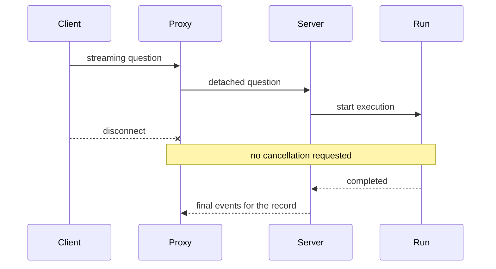
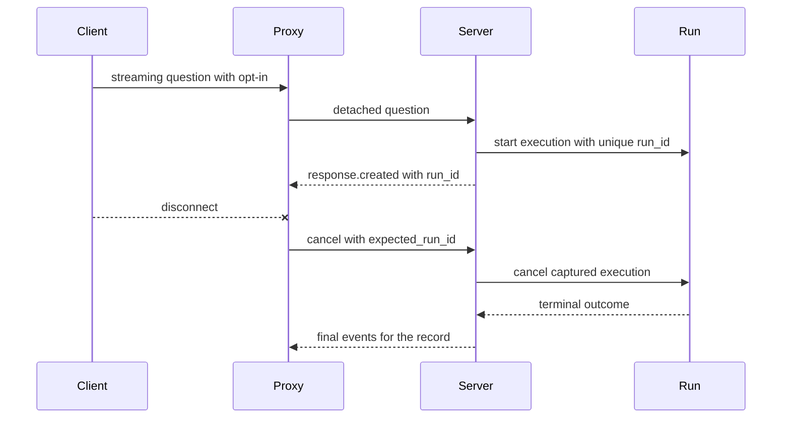
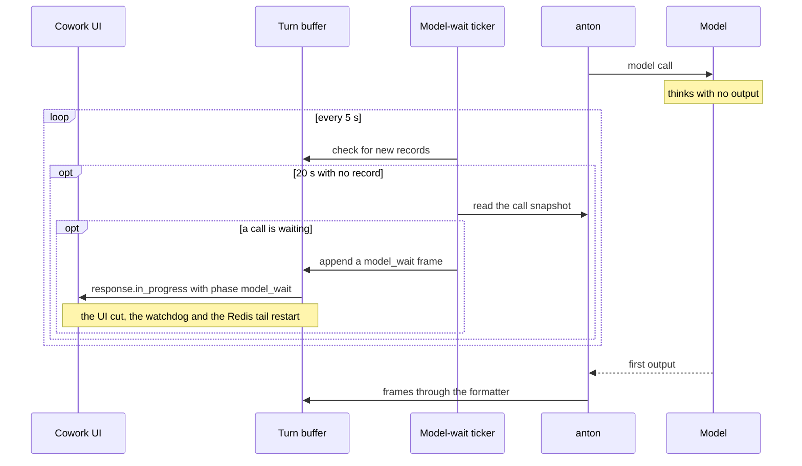

# Cowork Server API — Design Notes

## Architectural Overview

> Note (2026-09-10, ENG-2608): the Hermes harness described below was removed; Anton is the only shipped harness. Kept as historical rationale for the harness abstraction.

Given below is a high-level architectural overview of the Cowork Server API, specifically outlining how it differs from the implementation already available in the [mindsdb/cowork](https://github.com/mindsdb/cowork) repository. Some of these decisions have been made in order to simplify the onboarding of other agents (harnesses) such as Hermes.

Here is a breakdown:
### App Vs Harness Components
At the moment, most components of the existing Cowork server including projects, conversations, attachments etc., are closely coupled with the Anton agent. This means that when other agents (e.g., Hermes) are onboarded, they will have to either adhere to the structure Anton has defined for these components or implement their own versions.

A good example is the the work that has been done [here](https://github.com/mindsdb/cowork/compare/main...hermes-mvp); the base abstraction for harnesses here has been defined in such a way that conversation management and other aspects need to be implemented separately for each agent. This is not ideal as it leads to code duplication and makes maintenance harder.

Furthermore, it is not entirely clear how harness-specific components such as memory and skills work here. It seems to be necessary to use the contract defined by Anton and it is not guaranteed that these will work as intended for other agents.

A better way to approach this would be to have a clear separation between the app and harness components. The app components (e.g., projects, conversations, attachments) should be designed in a way that they are independent of any specific agent. We were already able to achieve in our implementation of the Minds API, where different implementations of agents could be onboarded with minimal changes to the core API.

The implementation available here aims to achieve this by taking parts of the both the existing codebase and the Minds API.

### Database Design
This implementation has also been designed to allow for database storage rather than relying on a file-based storage system. A lightweight SQLite database can be used here, but it is also able to support more robust databases such as Postgres if needed. This allows for better scalability and performance, especially as the number of users and conversations grows.

### API Design
The design of the API has also been hardened by removing several unusued endpoints and improving on the existing ones.

For example, the Responses API has been updated to allow for file inputs along with support for an OpenAI-compatible Files API. This alleviates the need for maintaining the /attachments endpoints defined in the orignial server defines a standard way for handling file uploads and attachments across different agents. More information regarding these design updates can be found in the design document linked below.

Further details regarding this design can be found in this document: [Cowork Server API for Agents](https://docs.google.com/document/d/1YBgr59GoO47wvLtZAO7wbNL8DKrigww_PYeUlcMDgos/edit?usp=sharing).

## Disconnect ownership and exact-run cancellation

A streaming POST owns its optional `cancel_on_disconnect` policy. The default remains
detached execution, so a browser can reload and tail an answer. A tail is an observer;
closing it never cancels the producer. Normal completion and server shutdown have their
own outcomes and must not be recorded as a client abandoning an answer.

The request captures its own run before exposing it to clients. A fresh `run_id` UUID
identifies that execution on its handle, its shared index and its `response.created` event.
The conversation's turn number can be reused after a run saved nothing, so it is not a
safe cancellation guard. The formatter's response ID retains its existing meaning.

An automatic cancel supplies `expected_run_id` to `/api/v1/responses/cancel`. Authorization
and the run guard are checked before cancellation. The cancellation path retains the
captured local handle and remote correlation identity across awaits; it never combines
an old handle with the conversation index's newer correlation. Remote dispatch must not
clear a cancellation after that execution becomes visible. Another replica relays the
request to the owning process or worker using the same immutable identity.

The self-hosted proxy owns the connection from its downstream client. It consumes the
option and leaves its upstream connection detached, then calls the guarded endpoint when
that client leaves. Keeping the upstream connection open lets it record the actual final
event. A failed cancel request is an attempt with a failed outcome, not a cancelled answer.

### Default behavior

### Opted-in behavior

For direct clients, cowork-server owns the originating connection and invokes the same
cancellation path without a proxy request. If the client leaves during preparation, cleanup
must prevent that request from leaving a live producer behind.

## One turn per conversation across replicas

TLDR; On the Redis stream backend, a conversation's turn claim (`cowork/streaming/turn_claim.py`) is what every replica reads to refuse a second question while a turn answers. The run holding it renews it, releases it after its stream's terminal record, and alone writes the conversation's turn index entry. The file backend never touches it.

`RunRegistry.start` checks its own process first, as on one replica. On the Redis backend it then takes the claim by compare-and-set (WATCH, GET, then SET with PX inside MULTI), before it opens the turn's buffer, so a refused start writes nothing. Compare-and-set runs as WATCH/MULTI rather than Lua, since the tests' fakeredis runs no Lua. fakeredis differs from Redis in two more ways the tests allow for. Its commands never suspend the event loop, so a test of racing starts makes each fakeredis reply suspend once, and `tests/integration/test_two_replicas.py` races them on a real Redis too. Its EXEC also runs after a watched key expired, where Redis 6.0.9 and later aborts it; the claim is right either way, since a renewal whose key expired under its WATCH reads again on Redis and takes the key back. The key `cowork:turn_claim:<conversation_id>` holds a `TurnClaim` (run id, turn number, correlation id, the pod's name and the start time) and lapses 90 s after the last renewal. The hash `cowork:turn_claims` lists every claim by conversation, and keeps the listing of a claim that lapsed without a release until a boot pass removes it. A channel turn takes none of these. It holds the key `cowork:channel_turn_lease:<conversation_id>` instead, from its staging to its end, so a message that reaches another replica waits rather than rewriting the project files' copy the turn before it still reads (`conversation_turn_lease` in `cowork/channels/runtime.py`). The lease holds a new owner token for each turn and keeps the claim's TTL and renewal interval; the turn asks for it again every 0.5 s while another replica's turn holds it.

What admission does with a claim another run holds:

| The holder's stream | Admission |
| -- | -- |
| No record yet, or streaming | `409 turn_in_progress`, the body a turn on the same replica gets |
| Writing its final client frame | Waits up to 10 s for the holder to release the claim, then takes it, or refuses with `409` |
| Ended, with the claim still there | Waits up to 10 s for the holder to release the claim. A claim still there after that is deleted by compare-and-delete on its run id, and admission tries once more |
| Redis does not answer | `503 server_busy` with `Retry-After: 2`. An acquire cut short is undone by compare-and-delete first, and an undo Redis does not answer either is tried again every second until it lands or the claim lapses, so the client's retry does not meet its own claim from about a second after Redis answers again |

A claim this replica's own last turn still holds after that turn's task ended is deleted at once by compare-and-delete: that turn's last writes failed, so it kept the claim over a stream with no terminal record, or its release failed. Another replica cannot tell that run ended, and waits for the claim's TTL.

Admission never writes to another run's stream. When a claim is absent, a start is admitted as it was before claims existed, even when the conversation's last turn died with its stream open, unless the turn index shows it is stale (below).

The early check in `POST /responses/` reads the claim too, before any database read. Where conversations are partitioned, it counts a claim only when the turn index entry its run wrote names the caller as the owner, so a refusal never reveals another user's turn.

A running turn renews its claim every 10 s from a task beside the cancel watch (`turn_claim.keep_claim`), and stops once its buffer is closed or writing its final client frame. A renewal that finds the key gone takes it back while the turn's stream has no terminal record. A Redis error is tried again at the next renewal and never counts as a lost claim. A renewal that finds another run holding the claim, or the stream ended by someone else, logs `turn_claim_lost` with the conversation, the run, and the holder's run and pod, once until a renewal holds the claim again. The turn goes on renewing, so once the other run releases the claim, the next renewal takes it back while the turn's stream has no terminal record.

A turn releases its claim only once its stream has a terminal record: when it completes, is stopped or fails, after `RunRegistry.shutdown` seals a stream its producer left open, and when its conversation is deleted. A delete served by the replica running the turn releases the claim itself. A renewal that was already running when that delete landed can take the deleted turn's claim back, and the keeper then releases it again. A delete served by another replica reads the claim before it forgets the turn index entry, and writes the holding run's cancel flag with the cause `discarded` (`registry.discard_conversation`). That run reads the cause when the cancel reaches it, from its cancel watch or, for a sandbox turn, from the controller's cancel reply. It then stops as a local delete stops a turn: it saves nothing into the deleted history, writes no terminal record, deletes the stream records it wrote after the delete, and releases its claim. A send is admitted once it has stopped. A flag that cannot be written is logged as `turn_discard_cancel_failed`, and every replica then refuses sends into the conversation until that turn ends. A release Redis does not answer is tried again every second until it lands or the claim lapses (`turn_claim.release_quietly`).

On the Redis backend, a turn refused for another run's claim, or as stale, logs one WARNING at the check that refuses it: `turn_claim_held` with the holder's run and pod, or `turn_stale_refused` with the turn whose saved question made the start stale. The file backend logs `turn_stale_refused` at INFO, since only its own process's turn can refuse there.

A turn notes in its turn index entry that it saved its question (`saved_question`) as soon as it saves it (`registry.mark_question_saved`), and again before it releases its claim, with the release time (`released_at`). The stamp refuses stale starts until 5 minutes after that release (`turn_index.STALE_START_WINDOW_SECONDS`): a stale start's request is still in its routing gate, whose model calls are bounded at seconds. A release that wrote no stamp, because its process died or Redis did not answer, leaves no release time, and the stamp then refuses stale starts until the entry expires, an hour after the turn started. Every reader gets the entry as a `TurnIndexEntry` with all of its fields. On the Redis backend the stale-number check reads that stamp twice: in `RunRegistry.start` before the claim, and in the transaction that takes the claim (`turn_claim.acquire`). So a replica refuses a start whose history read predates another replica's save, also when that start waited for the other replica's turn to end or found its claim left over an ended stream, and the refused start deletes nothing. Where an entry exists it decides on every replica, the one that ran the turn included. A finished handle on this replica refuses a start only where the entry cannot say: when it names that handle's run with no stamp (both stamps failed), or when it is a channel turn's. Even then the handle refuses only until 5 minutes after its task ended, so an entry another run wrote, or a truncation another replica made, is never overruled by this replica alone. A channel turn, which no registry handle covers, writes its turn index entry only while no run holds the claim.

On the Redis backend only, a conversation delete writes the cancel flag of a run another replica holds the claim for (above), then forgets the turn index entry, then removes the turn buffers and releases the claim of a turn this replica runs, each whatever the others do. A forget that fails is logged as `turn_index_forget_failed`; the entry's stamp then refuses sends at or below its turn number until 5 minutes after that turn released its claim. A turn the delete stopped writes that release time only on an entry the forget left behind.

A process starting on the Redis backend releases the claims stamped with its own pod's name (`POD_NAME`, else the host name), since a fresh process holds no turn, and writes the controller's cancel flag for each of their turns, held or lapsed, right after its release (`cancellation.stop_controller_turn`), so their sandbox turns stop too. A container restarted in place, after an OOM kill or a crash, keeps the pod's name, so this ends the refusals its dead turns would cause when it starts again within 90 s of its last renewal. A liveness restart kills a stalled process only after its claims have lapsed: the probe gives up after about 60 s, and the SIGKILL lands after the 62 s grace. So the pass finds only those claims' listings, and it still stops their sandbox turns. It relies on one server process per pod, which `tests/test_turn_claim.py` pins for the hosted command. The same pass removes the listings in `cowork:turn_claims` whose claim key is gone or names another run: a pod killed mid-turn leaves those behind under a name no later process carries. A claim that has not lapsed yet when a pass runs waits for the next one.

What the claim does not do:

- Nothing ends a turn whose replica died without a shutdown. Its claim lapses after 90 s and the next send is admitted. Its stream stays open until a reader's idle cut ends it, and its question stays pending. Its sandbox turn runs on until it ends or reaches the controller's turn limit, and the next send in that conversation waits behind it. The boot pass of its pod's next process stops it, if that pod starts one, and so does a Stop on the dead turn sent before that next send.
- A live run whose key Redis evicted, or that could not renew it for 90 s, no longer holds the claim, and a send on another replica that read the history after its question was saved is admitted beside it, so two runs answer. The first run's next renewal finds the other holder, logs `turn_claim_lost`, and goes on answering. Redis's `evicted_keys` counter shows an eviction.
- The claim does not order database writes. A save that outlives its producer at shutdown (`_saves_past_their_deadline` in `cowork/handlers/responses.py`) can still be writing after the claim is released and another replica's turn starts.
- During the first rollout of the claim, a turn on a pod that predates it holds none, so a duplicate on a newer pod is admitted, as before. An older pod admits a duplicate of a newer pod's turn too, and its index write replaces the claimed run's entry, so a Stop that reaches another pod and the stale-number stamp miss that run until the last older pod stops.

## Turn liveness and idle bounds

TLDR; A turn that sends nothing for too long is ended by whichever idle bound fires first. While anton waits on a model call that sends no output, cowork-server (in cloud, the anton pod) writes a `model_wait` progress frame every 20 to 25 seconds, so no bound fires until anton's own 10-minute model-call deadline ends the call. In cloud, the controller's 600 s hard cap can end the turn first. A non-streamed call through MindsHub is ended sooner, by the gateway's 110 s budget.

### The bounds a quiet turn meets

Each bound watches a different wire. A bound restarts only on activity it can see, so a frame has to reach the buffer, and from there the client, to keep a turn alive.

| Bound | Value | Where | What restarts it | What happens at expiry |
| -- | -- | -- | -- | -- |
| UI idle cut | 300 s. After a `response.ask_user` frame: the question's `timeout_s` plus 300 s | cowork `src/renderer/cowork/api.js`, `STREAM_IDLE_TIMEOUT_MS` | Any SSE event with a `data:` line. The server's `: keepalive` comments do not count | The UI aborts the stream, calls `POST /api/v1/responses/cancel` with `reason: "stalled"` and shows "The response stalled and was ended." |
| SSE keepalive comment | Every 20 s of quiet | `SSE_KEEPALIVE_SECONDS` in `cowork/handlers/responses.py` | Not a bound | Keeps proxies from closing an idle connection. It never keeps a turn alive, so a hung server still meets the UI cut |
| Idle watchdog | 600 s, checked every 15 s | `COWORK_MAX_TURN_IDLE_SECONDS`, `cowork/streaming/registry.py` | Any record appended to the turn's buffer | The producer is cancelled and saves `response.failed` with code `anton_error` and "The response was interrupted before it finished. Please try again." The buffer closes `interrupted` |
| Redis tail | 300 s | `REDIS_TAIL_IDLE_TIMEOUT_SECONDS`, `cowork/streaming/buffer.py`. Only with `COWORK_STREAM_BACKEND=redis` | Any record in the turn's Redis stream. A run that holds the turn's claim restarts it too, and so does a claim the reader cannot read | The reader writes an `Interrupted` terminal record to the stream and logs `turn_tail_idle_cut` with the conversation and turn. It writes through a buffer object of its own, so the producer's own buffer stays open and its replica still refuses a second question |
| Reply idle | 600 s | `COWORK_TURN_REPLY_IDLE_TIMEOUT_SECONDS`. Only for remote turns | Any reply for this turn on the controller's reply stream | The turn fails with code `worker_unresponsive` |
| Controller stall window | 120 s | scratchpad-controller `turn_stall_timeout_seconds` | Any line from the turn's pod, including its heartbeat every 5 s | The controller ends the turn, and the user sees "This turn stopped producing output and was ended." |
| Controller hard cap | 600 s in total | scratchpad-controller `hard_turn_timeout_seconds` | Nothing | The controller ends the turn, and the user sees "This turn took too long and was stopped." In cloud this cap ends a stuck model call before anton's deadline does |
| Question timeout | 300 s, or the question's own `timeout_s` | `DEFAULT_TIMEOUT_S`, `cowork/harnesses/anton_harness/elicitor.py` | An answer ends the wait | anton receives a `timeout` answer and carries on |
| MindsHub gateway | Streamed: a keepalive comment every 15 s, and the stream ended after 1800 s with nothing else. Non-streamed: 110 s for the whole request | mindshub_inference `keepalive_interval_seconds`, `max_upstream_silence_seconds` and `nonstreaming_budget_seconds` | Streamed: any output that reaches the client. Non-streamed: nothing | Streamed: the gateway ends the stream. Non-streamed: the gateway answers 504 marked not to retry, and anton raises a transient provider error that its caller handles |
| SDK read timeout | 600 s per read | OpenAI SDK default | Any bytes, the gateway's keepalive comments included | A request whose response has not started is re-sent by the SDK, twice by default. A streamed call that goes quiet mid-response raises a read-timeout error, which the turn handles as an error |
| Model-call deadline | 600 s | anton `ANTON_MODEL_CALL_IDLE_TIMEOUT_S`. A value of 0 or less turns it off, and then a model call that never answers keeps the turn alive until the SDK, the gateway or a Stop ends it | Each event of a streamed call. A non-streamed call gets one bound over the whole call. Both keep running across the SDK's own retries | anton raises `ModelCallTimeoutError`. The turn saves `response.failed` with code `model_timeout` and closes `error`. Inside the completion verifier it instead ends the turn quietly on the answer that already streamed |
| Model-wait tick | Written after 20 s of quiet, checked every 5 s | `MODEL_WAIT_TICK_SECONDS` and `MODEL_WAIT_POLL_SECONDS`, `cowork/streaming/liveness.py`. In cloud: anton's pod heartbeat and `MODEL_WAIT_TICK_S` | Not a bound | Restarts every bound above that watches the buffer, the reply stream or the SSE stream |

A model-call deadline above 600 s needs the SDK's read timeout raised too. On an endpoint that sends no keepalives, a streamed call that goes quiet after its response starts ends at 600 s with a read-timeout error instead of the deadline.

### How a silent model call stays alive

anton keeps a per-turn record of its open model calls and exposes it as `session.model_calls`. Its `snapshot()` names the oldest call that is waiting on the provider, or returns `None`.

On desktop and self-hosted, the turn's producer runs a `ModelWaitTicker` beside the formatter loop. The anton harness attaches its session to the ticker once the session exists. Every 5 seconds the ticker checks the buffer. When no record has arrived for 20 seconds and the snapshot names a waiting call, it appends one `response.in_progress` frame with `phase: "model_wait"` and a message such as "Waiting for the model (2m 40s)". The frame goes straight to the buffer and never through `event_sink`, so the turn's saved events never hold it.

In cloud, the pod's 5-second heartbeat task makes the same check against its own output and writes a `progress` line with `phase: "model_wait"`. The controller relays it, and the formatter turns it into the same frame. The formatter never throttles it and never saves it.

### Why ticks never fire during tools, cells or questions

A frame goes out only while anton reports a call waiting on the provider. Everything else that can hang a turn reports nothing, so it still meets every bound:

- **Tools.** While a tool runs its own code, no model call is waiting. A tool that calls the model itself, such as `generate_artifact`, keeps the turn alive only while that call waits on the provider. Its calls are non-streamed, so on MindsHub the gateway's 110 s budget ends one first. A tool that never returns is reaped by the watchdog at 600 s and cut by the UI at 300 s.
- **Scratchpad cells.** A cell runs in its own process. Its model calls never register on the turn's record, so a cell gets the same bounds as any tool.
- **Questions.** anton's snapshot returns `None` while an `ask_user` question is open. The UI extends its own window for the question instead.
- **A call parked between events.** Only a call awaiting the provider counts. A stream that has handed anton an event and waits for anton to ask for the next one does not.
- **A frozen or dead process.** The ticker runs inside the server process, so it freezes and dies with it. A hung server, a stopped sidecar or a dead proxy still meets the UI cut.

An anton without `session.model_calls` produces no ticks, and the turn meets the bounds above unchanged.

### What a stall and a Stop save

The UI's idle cut and the Stop button call the same endpoint. The optional `reason` tells them apart.

- **Stop** (no `reason`). The server saves the partial answer and its events with no terminal event, and the buffer closes `cancelled`. The live UI receives `response.cancelled`. A reload shows the partial answer with no error row.
- **Stall** (`reason: "stalled"`). `cancel_response` sets `TurnLifecycle.stalled` before it cancels the producer, and every later cancel sets it again from its own reason. So a Stop after a stall cancel the turn swallowed, such as one a running cell caught, saves as a Stop. The producer saves the partial answer, retires any open question, and appends `response.failed` with code `stalled` and "The response stalled and was ended. Please try sending again." The buffer closes `interrupted`, with no `response.cancelled`. A reload shows the stall card with Try again.
- **Stall on a replica that does not own a cloud turn.** That replica can only write Redis keys. In one transaction it sets `cowork:cancel_cause:<correlation_id>` = `stalled` and the cancel flag, both with a 300 s TTL. A client-disconnect cancel stores `client_gone`, and a conversation delete on a replica that does not run the turn stores `discarded`; other cancels delete the cause in the same transaction as the flag, so the latest cancel decides. The controller stops the pod, reports `turn_failed "cancelled"`, and its `_clear_cancel` deletes the flag. The owning replica reads the cause key when that report arrives and saves the stall record. If it cannot read the key, it logs an error and saves the turn as a Stop. Registry-owned runs publish a unique correlation ID before dispatch and preserve its cancel flag and cause throughout startup. Legacy callers without a run ID clear stale flags before publishing their turn.
- **Watchdog or shutdown.** These win over a stall, and a shutdown wins over the watchdog. The watchdog's turn saves `response.failed` with code `anton_error` and "The response was interrupted before it finished. Please try again." A shutdown's turn saves code `turn_lost` and "The server stopped before this answer finished. The answer ends where it was cut off. Please send your question again." Both close `interrupted`. A shutdown first writes a cloud turn's cancel flag, deleting any cause, so the controller stops the pod too; the owning replica saves the turn as interrupted whatever the controller then reports (`RunRegistry.shutdown`). A hosted replica does this on SIGTERM, before Uvicorn's drain, so the frame reaches the open stream (`deployment/cowork-server/README.md`).
- **Model-call deadline.** The turn saves `response.failed` with code `model_timeout` and anton's message, and closes `error`.
- **A crash.** Nothing saves the turn when the process dies. On the next boot, `seal_orphan_turns_in_history` (`cowork/streaming/recovery.py`) writes each turn whose buffer has no terminal record into its conversation with the text it streamed and `response.failed` with code `turn_lost`, so a reload shows it as lost. The client that held the stream lost its connection with the process. A proxy in front of the server that outlives it can end that stream with the same frame.

Any other `reason` value is accepted and ignored, so the turn saves as a Stop. A UI that sends no reason saves its stalls as a Stop. If a stall's cancel never reaches the server and the turn then completes, a reload shows the full answer.
